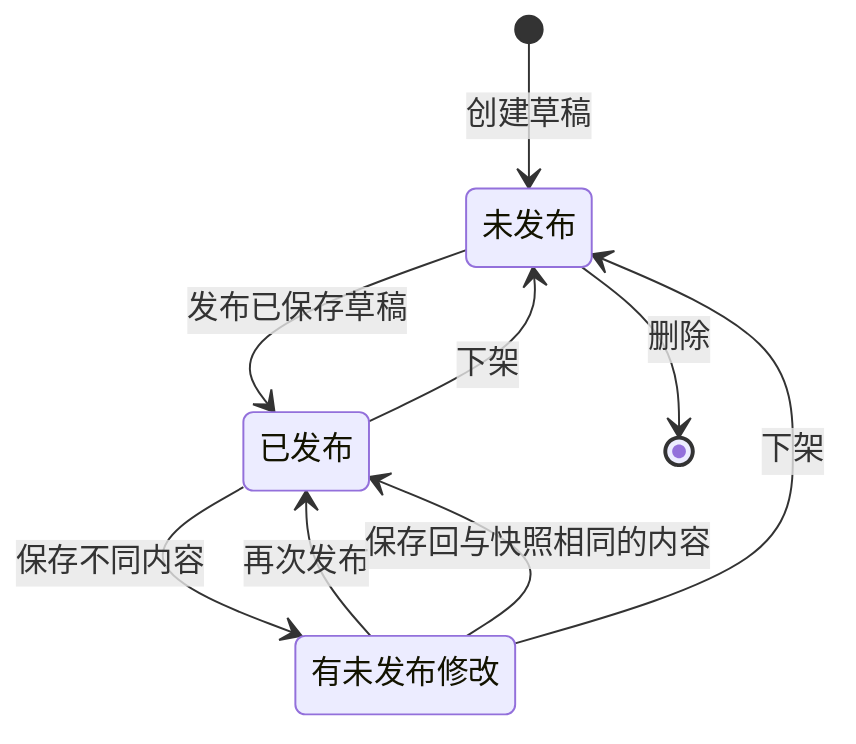

# 系统功能说明

适用版本：2026-10-19 当前工作区，Skill Inventory `1.0.0`，V2 数据结构。

## 1. 系统用途

Skill Inventory 是一个内部 Skill 内容管理与分发平台。管理员通过网页维护每个 Skill 的名称、描述和 Markdown 指令正文，审核内容后手动发布；外部服务通过 API Key 读取已发布内容，获得包含 YAML frontmatter 的完整 `SKILL.md`。

系统管理和分发内容，不运行正文里的指令、代码或脚本，不调用大模型，也不主动访问正文中的链接。每个 Skill 只有一个文档，没有附件目录、多文件包或执行环境。

## 2. 使用方与权限边界

| 使用方 | 认证方式 | 可以进行的操作 | 不能进行的操作 |
| --- | --- | --- | --- |
| 管理员 | 用户名/密码登录，服务端会话 Cookie | 管理全部 Skill；创建、查看和撤销 Key | 页面不提供注册、找回密码、多角色或历史版本回滚 |
| 外部服务 | 每次请求携带 `X-API-Key` | 读取全部已发布 Skill 的列表、JSON 详情、原文 | 读取草稿、管理 Skill、管理 Key |
| 未认证访问方 | 无 | 访问登录页面、获取 CSRF Token；部署健康检查 | 读取业务内容或管理数据 |

管理员浏览器会话不能替代外部接口要求的 API Key；API Key 不能替代管理员会话。Key 首版统一读取全部已发布内容，没有逐个 Skill 授权、租户隔离或不同 scope。

## 3. 功能清单

| 功能模块 | 当前能力 | 主要规则 |
| --- | --- | --- |
| 管理员登录 | 登录、查询当前用户、退出 | 无默认生产密码；首次从环境变量初始化，后续不覆盖 |
| Skill 列表 | 名称/描述关键词查询、状态筛选、分页 | 管理列表描述取草稿；按更新时间、ID 倒序 |
| 创建草稿 | 填写 name、description、content | 创建后未发布，对外不可读；name 创建后固定 |
| 编辑与预览 | 保存草稿，切换草稿/发布快照预览 | 草稿保存不影响当前分发内容；HTML 与图片渲染关闭并清洗结果 |
| 手动发布 | 将已保存草稿变成当前发布快照 | 有未保存输入时先保存；发布后外部读取新快照 |
| 下架 | 清除发布快照，保留草稿 | 下架后外部读取 404；不能撤销已下载副本 |
| 删除 | 物理删除未发布记录 | 已发布必须先下架；删除后允许复用 name，新记录有新 ID |
| API Key 管理 | 创建、分页查看、撤销 | 可选未来过期时间；完整 Key 只在创建响应中出现一次 |
| 外部读取 | 列表、详情、`SKILL.md` | 强制 Key；只读快照；支持 ETag/304 |
| 异常反馈 | 字段错误、登录失败、会话失效、版本冲突等 | HTTP 状态与 JSON 错误对应，含 requestId |

## 4. Skill 字段和输入约束

| 字段 | 含义 | 规则 |
| --- | --- | --- |
| name | Skill 的稳定名称，也是客户端查询路径的一部分 | 1–64 字符，小写英文字母、数字和单连字符；不允许首尾连字符或连续连字符；唯一且创建后不可修改 |
| description | 用途和适用场景说明 | 非空白，最多 1024 个 Java UTF-16 字符单元 |
| content | Markdown 指令正文 | 非空白，UTF-8 最多 262144 字节；不要粘贴文档级 YAML frontmatter |
| id | 数据库记录 ID | 系统生成；JSON 中用十进制字符串表达 |
| lockVersion | 乐观锁版本 | 系统维护；写操作使用当前版本，客户端不能自行递增 |

完整请求体上限 2 MiB。正文的 256 KiB 限制独立存在，即使请求体不到 2 MiB，也可能因正文超限而被拒绝。YAML 元数据由后端可靠序列化，不需要管理员手写。

## 5. 状态与生命周期

状态根据“有无快照、草稿是否与快照相同”实时计算，没有独立数据库状态列。

| 页面状态 | API 状态值 | 条件 | 外部服务实际看到的内容 |
| --- | --- | --- | --- |
| 未发布 | `UNPUBLISHED` | 没有发布快照 | 详情/原文 404，不在发布列表中 |
| 已发布 | `PUBLISHED` | 有快照，草稿与快照内容一致 | 当前发布快照 |
| 有未发布修改 | `MODIFIED` | 有快照，草稿与快照内容不同 | 仍是上一次发布快照 |

例子：先发布“原文 A”，再保存草稿“原文 B”，外部服务仍读到 A；只有再次点击发布后才读到 B。下架后不再分发 A 或 B，但草稿 B 仍可编辑和重新发布。

同内容保存、重复发布同内容、对已下架记录重复下架，不制造新内容版本；仍验证调用方的 lockVersion。旧版本操作返回 409，不自动覆盖其他修改。发布版本复用发布变更后的单调 lockVersion，允许跳号，下架后不会清零。

## 6. API Key 生命周期

1. 管理员输入名称和可选过期时间，创建 Key。
2. 在一次性区域立即复制并保存到调用方安全配置；关闭展示后不能重新查看。
3. 外部调用方将 Key 放入 `X-API-Key` 请求头，不能拼进 URL。
4. 需要轮换时，先创建新 Key、更新调用方并验证，再撤销旧 Key。
5. 丢失只能重建；撤销不可恢复，重复撤销保持原撤销时间。

列表显示名称、脱敏标识、创建/过期/撤销时间及计算出的 `ACTIVE`、`EXPIRED`、`REVOKED` 状态。数据库不保存完整 Key。撤销后的后续请求立即不再接受，包括带旧 ETag 的请求；已执行中的请求不会被回溯撤回。

## 7. 外部接口与缓存

| 方法 | 路径 | 返回内容 |
| --- | --- | --- |
| GET | `/api/v1/skills` | 已发布元数据分页，支持 keyword、page、pageSize |
| GET | `/api/v1/skills/{name}` | 发布元数据和完整 skillMd |
| GET | `/api/v1/skills/{name}/SKILL.md` | UTF-8 纯文本原文 |

先校验 Key，再读取发布快照，再判断 ETag。无 Key、错误、过期和撤销统一 401；有效 Key 读取草稿、下架或不存在资源统一 404。成功响应和 304 使用 `private, no-cache`，错误 `no-store`；共享缓存不能作为认证替代。

## 8. 当前交付边界

没有公开注册、多个管理员/角色配置、审批、密码自助找回、附件导入、历史版本、回滚、全文检索引擎、使用统计仪表盘、Skill 执行或 Agent 编排。默认部署仅发布前端端口，数据库和后端留在容器网络。仍面向受控网络，跨不可信网络调用必须使用 HTTPS。

代码依据：[SkillService](../backend/src/main/java/internal/skills/SkillService.java)、[Skill 状态计算](../backend/src/main/java/internal/skills/Skill.java)、[Key 管理](../backend/src/main/java/internal/skills/ApiKeys.java)、[页面入口](../frontend/src/main.ts)。具体操作见 [前端操作文档](04-前端操作文档.md) 和 [后端操作文档](05-后端操作文档.md)。
