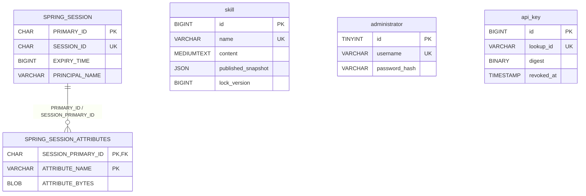

# 数据库结构说明

适用版本：2026-10-19 当前工作区，MySQL 8.4.6，Flyway V1 + V2。此文核对的是仓库迁移和读写实现，本次未连接或导出用户运行数据库。

## 1. 整体结构

应用包含 5 张表：`skill`、`administrator`、`api_key`、`SPRING_SESSION`、`SPRING_SESSION_ATTRIBUTES`。Flyway 另外维护 `flyway_schema_history`，共涉及 6 张表。

| 表 | 职责 | 创建方式 |
| --- | --- | --- |
| skill | 当前草稿及唯一当前发布快照 | V1 |
| administrator | 单管理员用户名、密码哈希 | V2 建表，启动初始化数据 |
| api_key | Key 摘要、公开标识及生命周期元数据 | V2 |
| SPRING_SESSION | 持久会话索引和有效期 | V2，Spring Session JDBC 读写 |
| SPRING_SESSION_ATTRIBUTES | 会话属性，包括认证上下文和 CSRF 相关状态 | V2，Spring Session JDBC 读写 |
| flyway_schema_history | 已执行迁移、校验和、执行状态等 | Flyway 自行创建维护 |



仅会话主表与属性表存在数据库外键。Skill 没有 owner_id，Key 没有 skill_id 或授权关联表；单管理员管理全部内容，每个有效 Key 读取全部已发布 Skill。`PRINCIPAL_NAME` 是会话查询索引，不是管理员表外键。

## 2. skill：草稿与发布快照

| 字段 | SQL 类型 | 可空/默认 | 说明 |
| --- | --- | --- | --- |
| id | BIGINT | 否，自增 | 主键，API 返回字符串 |
| name | VARCHAR(64) | 否 | 唯一名称，应用创建后不允许修改 |
| description | VARCHAR(1024) | 否 | 当前草稿描述 |
| content | MEDIUMTEXT | 否 | 当前草稿 Markdown 正文；应用另限 256 KiB UTF-8 |
| published_snapshot | JSON | 是 | 当前已发布快照；NULL 表示未发布/已下架 |
| lock_version | BIGINT | 否，默认 0 | 乐观锁，所有变更都验证版本 |
| created_at | DATETIME(6) | 否 | 创建时间 |
| updated_at | DATETIME(6) | 否 | 最后实质变更时间 |
| published_at | DATETIME(6) | 是 | 当前快照发布时间，清除快照时一并清空 |

索引：主键 `id`；唯一索引 `uk_skill_name(name)`；普通索引 `ix_skill_updated(updated_at DESC, id DESC)`。列表默认按 updated_at、id 倒序。关键词为 LIKE 模糊查询，没有全文索引；客户端筛选描述通过 JSON 提取发布描述。

该表 DDL 显式设置 `CHARACTER SET utf8mb4 COLLATE utf8mb4_0900_bin`。唯一性和数据库字符串比较遵循此配置。name 的格式、不可修改、正文长度、frontmatter 限制主要由应用校验实现，不能把直接 SQL 写入当作业务接口。

发布快照示例（示意业务数据）：

```json
{
  "name": "java-code-review",
  "description": "检查 Java 代码中的常见问题",
  "content": "# 操作步骤\n\n1. 阅读输入代码。",
  "publishedVersion": 3,
  "publishedAt": "2026-10-19T00:00:00Z"
}
```

JSON 由服务端生成并整体替换，没有历史快照数组。数据库没有 `status`、独立 `published_version` 列。`UNPUBLISHED/PUBLISHED/MODIFIED` 由草稿和快照计算，publishedVersion 存在 JSON 内。

实质写入使用 `WHERE id=? AND lock_version=?` 条件；成功后版本递增。保存草稿保留快照；发布原子替换快照；下架清空快照与发布时间；删除还要求快照为 NULL。无变化操作也在数据库条件写入中核对版本，但不增加版本或更新时间。此逻辑是显式 SQL 乐观锁，不是实体上的 JPA `@Version` 自动处理。

## 3. administrator：单管理员

| 字段 | SQL 类型 | 可空/默认 | 说明 |
| --- | --- | --- | --- |
| id | TINYINT | 否 | 主键；`CHECK (id = 1)` 固定单例 |
| username | VARCHAR(64) | 否 | UNIQUE 用户名 |
| password_hash | VARCHAR(100) | 否 | BCrypt 哈希，当前 cost=12 |

表中没有角色列、邮箱、锁定状态、审计时间或公开注册记录。认证时为该用户授予应用内 `ROLE_ADMIN`。

首次表为空时，从环境变量初始化；已有管理员时直接返回。初始化使用固定主键和不覆盖原值的重复键处理，避免并发创建重复管理员或重启覆盖密码。修改环境变量不会重置数据库密码。密码维护通过受控 BCrypt 哈希替换并失效会话完成，不能直接写明文密码。

## 4. api_key：只读凭证

| 字段 | SQL 类型 | 可空/默认 | 说明 |
| --- | --- | --- | --- |
| id | BIGINT | 否，自增 | 主键；管理 API 返回字符串 |
| name | VARCHAR(100) | 否 | 管理员填写的名称，非唯一 |
| lookup_id | VARCHAR(32) | 否 | UNIQUE 公开查找标识；实际生成 24 位十六进制字符，列使用 ascii/ascii_bin |
| digest | BINARY(32) | 否 | 完整 Key 的 SHA-256 二进制摘要，不是 64 字符十六进制字符串 |
| masked | VARCHAR(64) | 否 | 可展示公开前缀、标识及末尾 4 位 |
| created_at | TIMESTAMP(6) | 否 | 创建时间，应用显式传入 |
| expires_at | TIMESTAMP(6) | 是 | NULL 为不过期，创建时必须在未来 |
| revoked_at | TIMESTAMP(6) | 是 | NULL 为未撤销；重复撤销保留第一次时间 |

索引仅有主键及 lookup_id 唯一索引。列表使用主键倒序分页。不存完整 Key、lastUsedAt、权限 scope、独立状态列或逐条 Skill 权限。状态计算优先级：revoked_at 非空为 REVOKED；否则过期为 EXPIRED；否则 ACTIVE。

完整 Key 结构：`sk_<24位公开标识>_<64位随机十六进制密钥>`。公开标识来自 12 字节随机数，密钥部分来自 32 字节随机数。请求先按 lookup_id 查记录，再用 `MessageDigest.isEqual` 比较 SHA-256 摘要，最后检查过期和撤销信息。没有 Key 校验业务缓存，撤销不会等待缓存失效。

## 5. SPRING_SESSION：会话主表

| 字段 | SQL 类型 | 可空 | 说明 |
| --- | --- | --- | --- |
| PRIMARY_ID | CHAR(36) | 否 | 内部会话记录主键 |
| SESSION_ID | CHAR(36) | 否 | 会话 ID，唯一索引；不要与公开 Cookie 表示形式混为一谈 |
| CREATION_TIME | BIGINT | 否 | 创建时间，epoch 毫秒 |
| LAST_ACCESS_TIME | BIGINT | 否 | 最后访问时间，epoch 毫秒 |
| MAX_INACTIVE_INTERVAL | INT | 否 | 最大空闲间隔，秒 |
| EXPIRY_TIME | BIGINT | 否 | 过期时间，epoch 毫秒 |
| PRINCIPAL_NAME | VARCHAR(100) | 是 | 认证主体名称 |

约束/索引：`SPRING_SESSION_PK(PRIMARY_ID)`、唯一 `SPRING_SESSION_IX1(SESSION_ID)`、`SPRING_SESSION_IX2(EXPIRY_TIME)`、`SPRING_SESSION_IX3(PRINCIPAL_NAME)`。

使用 InnoDB、ROW_FORMAT=DYNAMIC。会话清理、属性保存和读取由 Spring Session JDBC 负责，不由业务接口手工序列化。有效期默认空闲 30 分钟，可通过 SESSION_TIMEOUT 配置；过期会话不再通过认证。持久化不等于永不过期。

## 6. SPRING_SESSION_ATTRIBUTES：会话属性

| 字段 | SQL 类型 | 可空 | 说明 |
| --- | --- | --- | --- |
| SESSION_PRIMARY_ID | CHAR(36) | 否 | 引用会话主表 PRIMARY_ID |
| ATTRIBUTE_NAME | VARCHAR(200) | 否 | 属性名称 |
| ATTRIBUTE_BYTES | BLOB | 否 | Spring Session 序列化后的属性数据 |

联合主键：`(SESSION_PRIMARY_ID, ATTRIBUTE_NAME)`。外键 `SPRING_SESSION_ATTRIBUTES_FK` 引用 `SPRING_SESSION(PRIMARY_ID)`，`ON DELETE CASCADE`。不要直接编辑 BLOB，不把它当作 JSON 或明文 Token 字段。备份与数据库访问权限必须覆盖会话敏感数据的保护。

会话两张表与项目实际采用的 Spring Session JDBC 3.5.7 MySQL schema 对齐；配置 `spring.session.jdbc.initialize-schema=never`，建表依靠迁移。

## 7. flyway_schema_history：迁移记录

此表由 Flyway 管理，非应用业务模型。通常记录 installed_rank、version、description、type、script、checksum、installed_by、installed_on、execution_time、success 等信息；精确结构由当前 Flyway 创建，不能擅自手改校验和以跳过迁移错误。

| 迁移 | 内容 | 对既有数据的影响 |
| --- | --- | --- |
| V1__create_skill.sql | 创建 Skill 表 | 首版基础结构 |
| V2__authentication.sql | 新增管理员、Key、会话表 | 不修改或删除既有 Skill 记录 |

新增结构继续添加 V3、V4 等迁移，不改已经在目标库执行过的 V1/V2。Hibernate 当前 `ddl-auto=validate`，只验证，不负责自动重建业务表。升级先备份，再保留原项目名和数据卷启动，让 Flyway 执行缺失迁移。

## 8. 时间、字符集及读写约定

- Skill 时间为 DATETIME(6)，Key 时间为 TIMESTAMP(6)，会话时间为 epoch 毫秒，不能用同一种原始格式解读所有表。
- 应用使用 Instant；JDBC 连接、Hibernate 和 Compose 数据库时区按 UTC 配置；API 时间为带时区 ISO 8601，页面按浏览器本地时间显示。
- Skill 表显式指定 utf8mb4 二进制排序规则；V2 大多数文本列继承数据库默认字符集/排序规则，lookup_id 单独指定 ascii_bin。Compose 为 MySQL 设置 utf8mb4/utf8mb4_0900_bin；接入自建数据库时要核对库默认值，不能假定所有列 DDL 都单独写了相同排序规则。
- 没有自动更新时间、密码重置或 Key 状态触发器，时间和业务规则由应用控制。
- 对外的 Skill/Key BIGINT ID 为 JSON 字符串，版本为 JSON 整数；不要在前端把 ID 转成 Number。

源码依据：[V1](../backend/src/main/resources/db/migration/V1__create_skill.sql)、[V2](../backend/src/main/resources/db/migration/V2__authentication.sql)、[实体](../backend/src/main/java/internal/skills/Skill.java)、[业务写入](../backend/src/main/java/internal/skills/SkillService.java)、[Key](../backend/src/main/java/internal/skills/ApiKeys.java)、[配置](../backend/src/main/resources/application.yaml)。
