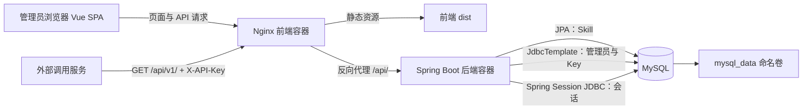
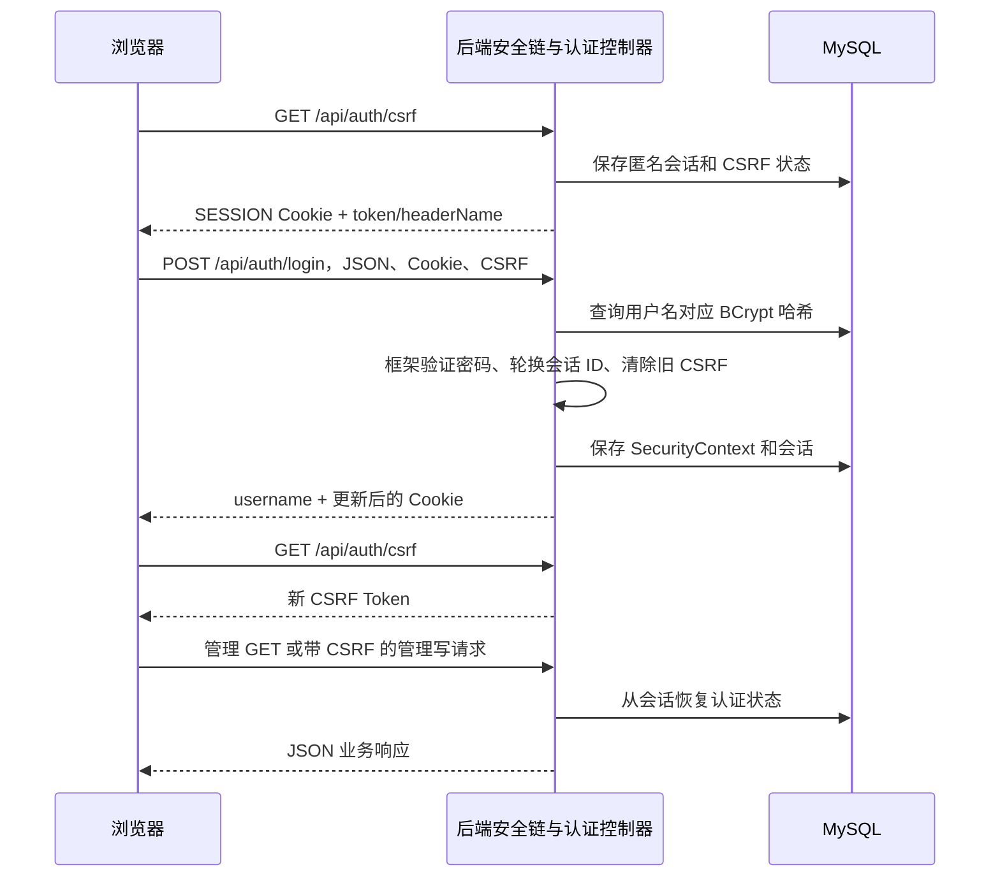
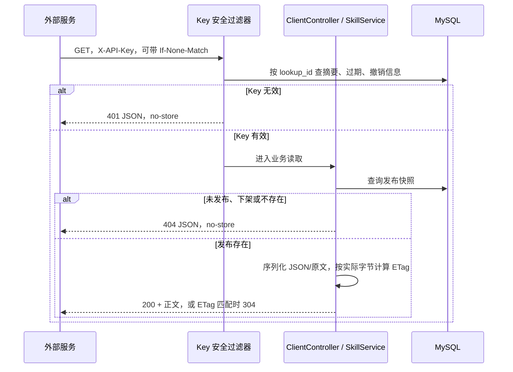

# 技术架构说明

适用版本：2026-10-19 当前工作区，Skill Inventory `1.0.0`。先按部署和职责理解系统，再看认证、发布和读取链路。

## 1. 总体架构

系统是 Vue 单页前端 + Spring Boot 单体 API + MySQL 的三服务部署。Nginx 同时提供页面静态文件和 `/api/` 反向代理，浏览器通过同一站点完成会话访问；外部服务使用同一个入口读取发布内容。MySQL 同时保存业务内容、管理员、Key 摘要和会话，不引入 Redis、消息队列或对象存储。

默认仅发布 `127.0.0.1:8088 → frontend:80`。backend:8080、mysql:3306 只在 Compose 网络中访问。后端以 app 非 root 用户运行；前端 `/healthz`、后端 `/actuator/health` 和 MySQL SELECT 1 用于健康检查。Nginx 的 `/healthz` 只证明前端存活，不能代替数据库及后端健康状态。

## 2. 技术栈与职责

以下为仓库固定版本或当前依赖解析版本，不代表对外推荐最新版本。

| 层次 | 技术 | 当前版本/配置 | 负责内容 |
| --- | --- | --- | --- |
| 前端界面 | Vue、Vue Router、TypeScript | 3.5.44、4.6.4、5.9.3 | 页面、表单、路由、类型约束 |
| 前端构建 | Vite、Node | Vite 8.3.4；Docker Node 22.20.0；package 要求 Node ≥22.12 | 开发代理和静态资源打包 |
| Markdown | marked、DOMPurify | 18.1.1、3.4.17 | Markdown 转 HTML、禁用原始 HTML/图片、结果清洗 |
| 网关/静态服务 | Nginx | 1.28.0 | SPA history 回退、API 代理、CSP、请求体限制 |
| API | Java、Spring Boot MVC | Java 21、Boot 3.5.16 | 控制器、校验、业务事务、统一错误 |
| 认证 | Spring Security | 当前解析 6.5.11 | BCrypt、认证管理器、授权、CSRF、退出 |
| 持久会话 | Spring Session JDBC | 当前解析 3.5.7 | 将认证会话持久化到 MySQL |
| 数据访问 | Spring Data JPA + EntityManager；JdbcTemplate | 由 Boot 管理 | Skill 查询与条件更新；认证/Key 的简单 SQL |
| 迁移 | Flyway | 11.16.0 | V1、V2 结构升级 |
| 数据库 | MySQL | 8.4.6 | 业务与会话持久化 |
| 文档序列化 | SnakeYAML | Boot 依赖管理 | 正确生成 YAML frontmatter |
| 测试 | JUnit/Spring Boot Test、Testcontainers、Vitest、Playwright | 版本见 pom/package-lock | 单元、真实 MySQL 集成、组件与浏览器验证 |

Skill 数据访问沿用 JPA，少量认证数据直接使用 Spring JDBC；没有同时引入 MyBatis 或另一套 ORM。

## 3. 代码与模块职责

| 位置 | 主要职责 |
| --- | --- |
| backend/.../Application.java | Spring Boot 入口 |
| RequestPolicy.java | requestId、Origin/Sec-Fetch-Site、CORS、JSON 媒体类型、2 MiB 请求限制 |
| SecurityConfig.java | 管理员初始化、BCrypt、两条安全链、会话上下文持久化和退出 |
| AuthController.java | CSRF 获取、登录、当前用户、每进程登录节流 |
| ApiKeys.java | Key 生成、摘要校验、列表、撤销及对应管理控制器 |
| Controllers.java | Skill 管理与客户端读取控制器，ETag/304 |
| SkillService.java | 草稿/发布/下架/删除规则、事务、版本条件写入、分页筛选 |
| Skill.java / SkillRepository.java | Skill 实体、快照结构与仓库查询 |
| Contracts.java / Errors.java / ApiException.java | 输入输出契约、统一错误与业务状态码 |
| SkillMd.java | 正文校验、YAML 生成、完整 SKILL.md 输出 |
| frontend/src/main.ts / App.vue | 路由守卫、页面框架、用户信息、退出与会话恢复提示 |
| Login.vue / List.vue / Editor.vue / ApiKeys.vue | 登录、目录、草稿编辑与预览、Key 管理 |
| frontend/src/api.ts | 同源 fetch、CSRF 内存状态、401/403 处理、错误展示和复制 |
| frontend/src/markdown.ts | Markdown 安全渲染 |
| frontend/nginx.conf / compose.yaml | 站点代理及服务编排 |

完整源码根目录：[后端包](../backend/src/main/java/internal/skills)、[前端源文件](../frontend/src)、[迁移](../backend/src/main/resources/db/migration)。

## 4. 管理员登录与后续请求

登录采用 Spring AuthenticationManager/DaoAuthenticationProvider。登录成功后显式调用会话认证策略，并通过 SecurityContextRepository 保存认证上下文，避免只在当前请求中设置身份。后续请求从 MySQL 会话恢复认证。

Cookie 为 HttpOnly、SameSite=Lax、Path=/；不使用 localStorage 登录令牌，不支持 URL 传会话 ID。默认空闲 30 分钟，HTTPS 部署配置 Secure。退出由 Spring Security 退出过滤器处理，失效服务端会话并清 Cookie，不是 AuthController 手写注销协议。

登录节流是每进程一个 60 秒窗口，最多 20 次有效格式尝试，成功/失败都计数；不会按任意用户名/IP 分配无界记录，也不会永久锁死账号。多实例各自计数，不能据此宣称分布式公网防爆破。

## 5. 两条认证边界

| 请求 | 使用的认证 | CSRF | 授权结果 |
| --- | --- | --- | --- |
| `/api/v1/**` | 只校验 Header API Key，不恢复管理员会话 | 此无状态客户端链关闭 | 有效 Key 才进入业务读取；实际只定义三个 GET 接口 |
| `/api/admin/**` | 管理员持久会话，需 ROLE_ADMIN | 写请求开启 | API Key 不能代替会话 |
| `/api/auth/login`、`/api/auth/csrf` | 登录前可调用 | 登录 POST 仍需 CSRF | 仅这些必要认证入口放行 |
| `/api/auth/me`、退出 | 管理员认证/框架退出处理 | 退出 POST 需 CSRF | 认证状态查询与会话失效 |
| `/actuator/health` | 内部健康检查放行 | 不涉及写入 | 不返回组件敏感详情 |
| 其他后端路径 | 默认拒绝 | 依安全链处理 | 不开放无认证业务旁路 |

RequestPolicy 还会先执行媒体类型、来源和大小检查，因此恶意来源/非 JSON/超大请求可能在会话授权之前分别收到 403/415/413。正常格式的未登录管理读写返回 401 JSON，不跳 HTML 登录页。

## 6. 草稿保存和发布链路

1. Vue 持有当前草稿字段、已保存基线和 lockVersion，展示本地 dirty 状态。
2. 管理请求通过会话、CSRF、来源及输入校验后进入 SkillService。
3. 服务在事务中读取当前记录，比较请求版本，判断内容是否实质变化。
4. 使用 `UPDATE ... WHERE id=:id AND lock_version=:v` 完成原子条件更新；删除另要求快照为空。
5. 影响行数不是 1 则返回 409；成功后清理 JPA 一级缓存并读取新状态。
6. 保存只改草稿；发布构造新的 Published JSON；下架清空快照及发布时间。
7. 前端接收成功响应更新基线；遇到版本冲突保留输入，由管理员复制、刷新、合并，不自动重放。

数据库配置 `useAffectedRows=false` 使无变化条件写入仍能按匹配记录核对版本。前端路由守卫只改善页面体验，真正权限检查位于服务端过滤器。

## 7. 外部读取与条件缓存链路

Key 安全过滤器先于业务和 ETag 判断运行，因此旧标签不能绕过撤销/过期认证。ETag 按实际响应字节 MD5 生成，是缓存校验标记，不承担密码或凭证安全用途。完整 SKILL.md 由 SnakeYAML 序列化元数据后追加原始 Markdown。

客户端成功与 304 设置 `Cache-Control: private, no-cache`，增加 `Vary: X-API-Key` 并保留必要的 Origin 变化头。错误 `no-store`。Nginx `proxy_cache off` 且透传 Key，不做内容缓存。下架停止后续分发，无法清除调用方已下载文件。

## 8. 安全和可观测性

- 数据库存 BCrypt 哈希和高熵 Key 的 SHA-256 摘要；Key 摘要使用恒定时间比较。
- 每个请求生成 requestId，错误采用 `{code,message,requestId}`，响应头同时带 X-Request-Id。没有集中式链路追踪或审计平台。
- Nginx 与后端均限制 2 MiB，正文另限 256 KiB；HTTP 请求头上限 16 KiB。
- Vue 的 marked 禁用原始 HTML 和图片，再用 DOMPurify 清洗；部署 CSP 进一步限制脚本、连接和资源来源。
- Origin 使用显式白名单；CORS 允许凭证时不返回通配符。来源检查不代替认证。
- 当前 Nginx 禁用访问日志，应用避免输出正文和凭证；后续接入网关或监控时必须继续保护 Header、Cookie 和正文。

## 9. 运行边界与演进约束

当前没有 Redis、消息队列、搜索引擎、对象存储、LLM 或外部 SaaS 运行依赖。运行时主要依赖内部 MySQL；构建阶段需要 Maven/npm 及镜像仓库。数据库使用命名卷，普通 down/up 不删除数据。

文档和代码已有本地功能验证，未证明公网生产安全、生产高可用、多实例登录节流统一、海量数据性能或跨浏览器完整兼容。新增业务结构需新增 Flyway 迁移；变更会话序列化相关类或框架版本时，应单独验证既有持久会话兼容性。

进一步操作见 [前端操作文档](04-前端操作文档.md)、[后端操作文档](05-后端操作文档.md)，数据库字段见 [数据库结构说明](02-数据库结构说明.md)。
